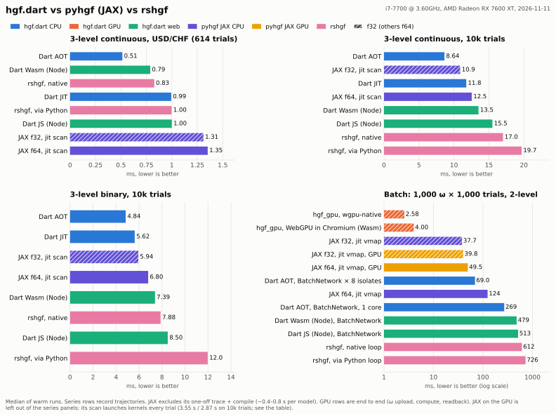
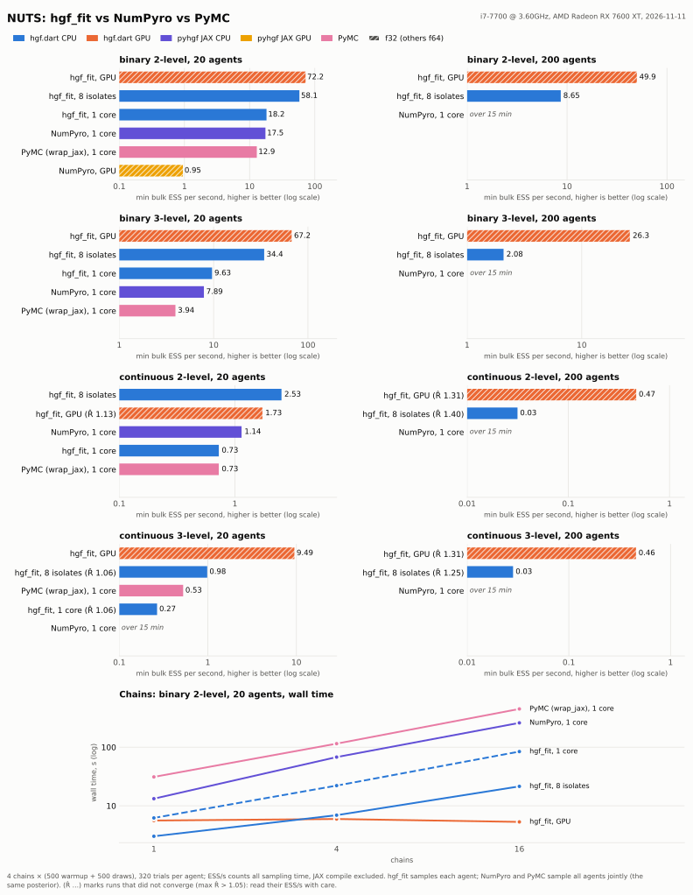
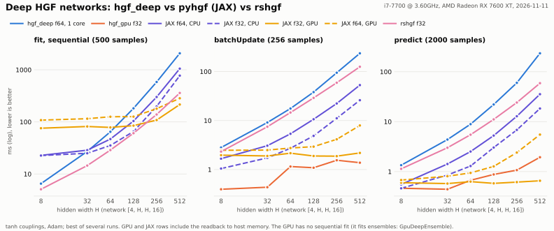

# Benchmark results

Generated by `dart run tool/bench_compare.dart` on 2026-11-11.

- Machine: Intel(R) Core(TM) i7-7700 CPU @ 3.60GHz, 8 threads, linux
- Dart 3.13.7; Node v26.13.0
- Median of 7 warm runs, milliseconds (lower is better). JAX on CPU in float64 (`jax_*`, like-for-like with the float64 Dart port) and in float32 (`jax_*_f32`, pyhgf's default); `jax_first_call*` is trace + compile + first run. `*_no_traj` skips trajectory recording.
- `gpu_*_f32`: hgf_gpu's WGSL kernel (f32, one thread per ω) on AMD Radeon RX 7600 XT, end to end (ω upload, dispatch, readback); `gpu_webgpu_f32` is WebGPU in headless Chromium (dart2wasm).
- `jax_*_gpu*`: pyhgf JAX on the same GPU (JAX 0.9.0 (ROCm 7.13), AMD Radeon RX 7600 XT; `tool/parity/jax_rocm.sh`), timed to results in host memory. Its `scan` launches kernels every trial, which is why the series rows are slow there.

<picture>
  <source media="(prefers-color-scheme: dark)" srcset="benchmark-dark.svg">
  
</picture>

Redraw with `melos run bench:plot`.

| backend | continuous_3level_usdchf_614 | continuous_3level_10k | binary_3level_10k | batch_1000x1000_continuous_2level |
|---|--:|--:|--:|--:|
| rshgf | 1.00 | 19.7 | 12.0 | |
| rshgf_no_traj | 0.73 | 11.4 | 6.83 | |
| jax_first_call | 691 | 611 | 377 | 688 |
| jax_input_data | 2.31 | 13.9 | 8.34 | |
| jax_jit_scan | 1.35 | 12.5 | 6.80 | |
| rshgf_loop | | | | 726 |
| jax_vmap | | | | 124 |
| jax_first_call_f32 | 726 | 619 | 370 | 632 |
| jax_input_data_f32 | 2.37 | 12.0 | 7.25 | |
| jax_jit_scan_f32 | 1.31 | 10.9 | 5.94 | |
| jax_vmap_f32 | | | | 37.7 |
| jax_first_call_gpu | 1593 | 4706 | 3022 | 810 |
| jax_input_data_gpu | 229 | 3508 | 2206 | |
| jax_jit_scan_gpu | 227 | 3549 | 2232 | |
| jax_vmap_gpu | | | | 49.5 |
| jax_first_call_gpu_f32 | 2344 | 4774 | 3034 | 909 |
| jax_input_data_gpu_f32 | 189 | 2894 | 1950 | |
| jax_jit_scan_gpu_f32 | 187 | 2875 | 1920 | |
| jax_vmap_gpu_f32 | | | | 39.8 |
| rshgf_native | 0.83 | 17.0 | 7.88 | |
| rshgf_native_no_traj | 0.64 | 10.8 | 5.91 | |
| rshgf_native_loop | | | | 612 |
| dart_aot | 0.51 | 8.64 | 4.84 | |
| dart_aot_no_traj | 0.42 | 7.29 | 3.38 | |
| dart_aot_loop | | | | 367 |
| dart_aot_batch | | | | 269 |
| dart_aot_isolates | | | | 80.8 |
| dart_aot_batch_isolates | | | | 69.0 |
| dart_jit | 0.99 | 11.8 | 5.63 | |
| dart_jit_no_traj | 0.52 | 8.60 | 4.60 | |
| dart_jit_loop | | | | 487 |
| dart_jit_batch | | | | 286 |
| dart_jit_isolates | | | | 122 |
| dart_jit_batch_isolates | | | | 97.0 |
| dart_js | 1.00 | 15.5 | 8.50 | |
| dart_js_no_traj | 0.85 | 13.5 | 7.00 | |
| dart_js_loop | | | | 786 |
| dart_js_batch | | | | 513 |
| dart_wasm | 0.79 | 13.5 | 7.39 | |
| dart_wasm_no_traj | 0.62 | 10.1 | 4.93 | |
| dart_wasm_loop | | | | 598 |
| dart_wasm_batch | | | | 479 |
| gpu_native_f32 | | | | 2.58 |
| gpu_webgpu_f32 | | | | 4.00 |

## NUTS (`melos run bench:nuts-sweep`)

Binary (b) and continuous (c) 2- and 3-level HGFs, 320 trials per agent, 500 warmup + 500 draws per chain. hgf_fit samples each agent (`hgf_cpu1`: one isolate; `hgf_pool8`: `FitWorkers`, 8 isolates; `hgf_gpu`: `GpuFitter`, f32). NumPyro and PyMC sample all agents jointly, the same posterior, on the pyhgf model that hgf_fit's `PythonExport` writes for each Dart model; CPU runs are pinned to one core. Seconds are sampling time (NumPyro's compile, measured on a short run, is subtracted); ESS is the minimum bulk ESS over all agents' parameters. JAX on this GPU needs ~40 ms per gradient of 20 agents (0.6 ms on the CPU: its scan launches kernels every trial), so NumPyro runs on the GPU for one cell only.

<picture>
  <source media="(prefers-color-scheme: dark)" srcset="benchmark_nuts-dark.svg">
  
</picture>

| model | agents | chains | backend | s | min ESS | min ESS/s | max R̂ | divergences |
|---|--:|--:|---|--:|--:|--:|--:|--:|
| b2 | 20 | 1 | hgf_cpu1 | 6.2 | 68 | 11.0 |  | 1 |
| b2 | 20 | 1 | hgf_pool8 | 3.0 | 68 | 22.5 |  | 1 |
| b2 | 20 | 1 | hgf_gpu | 5.6 | 96 | 17.1 |  | 0 |
| b2 | 20 | 1 | numpyro_cpu_f64 | 13.2 | 233 | 17.6 |  | 0 |
| b2 | 20 | 1 | pymc_cpu_f64 | 31.1 | 386 | 12.4 |  | 0 |
| b2 | 20 | 4 | hgf_cpu1 | 22.1 | 401 | 18.2 | 1.011 | 2 |
| b2 | 20 | 4 | hgf_pool8 | 6.9 | 401 | 58.1 | 1.011 | 2 |
| b2 | 20 | 4 | hgf_gpu | 5.9 | 429 | 72.2 | 1.009 | 2 |
| b2 | 20 | 4 | numpyro_cpu_f64 | 67.8 | 1186 | 17.5 | 1.004 | 1 |
| b2 | 20 | 4 | numpyro_gpu_f32 | 1131.8 | 1071 | 0.9 | 1.008 | 1 |
| b2 | 20 | 4 | pymc_cpu_f64 | 114.9 | 1482 | 12.9 | 1.009 | 1 |
| b2 | 20 | 16 | hgf_cpu1 | 84.2 | 1778 | 21.1 | 1.006 | 3 |
| b2 | 20 | 16 | hgf_pool8 | 21.4 | 1778 | 82.9 | 1.006 | 3 |
| b2 | 20 | 16 | hgf_gpu | 5.3 | 2012 | 379.4 | 1.007 | 6 |
| b2 | 20 | 16 | numpyro_cpu_f64 | 260.1 | 5001 | 19.2 | 1.005 | 2 |
| b2 | 20 | 16 | pymc_cpu_f64 | 449.8 | 5818 | 12.9 | 1.005 | 4 |
| b2 | 200 | 4 | hgf_pool8 | 50.3 | 435 | 8.7 | 1.013 | 40 |
| b2 | 200 | 4 | hgf_gpu | 8.0 | 401 | 49.9 | 1.020 | 26 |
| b2 | 200 | 4 | numpyro_cpu_f64 | > 900 |  |  |  |  |
| b3 | 20 | 4 | hgf_cpu1 | 67.8 | 652 | 9.6 | 1.011 | 1 |
| b3 | 20 | 4 | hgf_pool8 | 19.0 | 652 | 34.4 | 1.011 | 1 |
| b3 | 20 | 4 | hgf_gpu | 8.8 | 591 | 67.2 | 1.007 | 2 |
| b3 | 20 | 4 | numpyro_cpu_f64 | 200.3 | 1580 | 7.9 | 1.006 | 1 |
| b3 | 20 | 4 | pymc_cpu_f64 | 333.7 | 1314 | 3.9 | 1.006 | 1 |
| b3 | 200 | 4 | hgf_pool8 | 152.1 | 316 | 2.1 | 1.017 | 276 |
| b3 | 200 | 4 | hgf_gpu | 14.6 | 384 | 26.3 | 1.018 | 250 |
| b3 | 200 | 4 | numpyro_cpu_f64 | > 900 |  |  |  |  |
| c2 | 20 | 4 | hgf_cpu1 | 123.2 | 89 | 0.7 | 1.040 | 0 |
| c2 | 20 | 4 | hgf_pool8 | 35.4 | 89 | 2.5 | 1.040 | 0 |
| c2 | 20 | 4 | hgf_gpu | 13.1 | 23 | 1.7 | 1.135 | 0 |
| c2 | 20 | 4 | numpyro_cpu_f64 | 314.2 | 359 | 1.1 | 1.018 | 0 |
| c2 | 20 | 4 | pymc_cpu_f64 | 429.9 | 312 | 0.7 | 1.014 | 0 |
| c2 | 200 | 4 | hgf_pool8 | 275.8 | 9 | 0.0 | 1.400 | 0 |
| c2 | 200 | 4 | hgf_gpu | 22.0 | 10 | 0.5 | 1.310 | 0 |
| c2 | 200 | 4 | numpyro_cpu_f64 | > 900 |  |  |  |  |
| c3 | 20 | 4 | hgf_cpu1 | 188.8 | 50 | 0.3 | 1.062 | 0 |
| c3 | 20 | 4 | hgf_pool8 | 51.3 | 50 | 1.0 | 1.062 | 0 |
| c3 | 20 | 4 | hgf_gpu | 14.5 | 137 | 9.5 | 1.035 | 0 |
| c3 | 20 | 4 | numpyro_cpu_f64 | > 900 |  |  |  |  |
| c3 | 20 | 4 | pymc_cpu_f64 | 767.5 | 404 | 0.5 | 1.013 | 0 |
| c3 | 200 | 4 | hgf_pool8 | 426.0 | 12 | 0.0 | 1.250 | 0 |
| c3 | 200 | 4 | hgf_gpu | 22.1 | 10 | 0.5 | 1.312 | 0 |
| c3 | 200 | 4 | numpyro_cpu_f64 | > 900 |  |  |  |  |

## Deep HGF networks (`melos run bench:deep-sweep`)

tanh networks [4, H, H, 16] (output layer first), Adam, best of several runs, ms: `fit` is sequential over 500 samples, `batch_update` takes 256 samples, `predict` 2000. hgf_deep runs on one core in f64; GPU and JAX-on-GPU rows include the readback to host memory. The GPU has no single sequential fit (`GpuDeepEnsemble` fits many at once).

<picture>
  <source media="(prefers-color-scheme: dark)" srcset="benchmark_deep-dark.svg">
  
</picture>

| op | backend | H=8 | H=32 | H=64 | H=128 | H=256 | H=512 |
|---|---|--:|--:|--:|--:|--:|--:|
| fit | hgf_deep | 6.53 | 27.1 | 64.6 | 182 | 583 | 2072 |
| fit | jax_cpu_f64 | 22.8 | 28.6 | 46.8 | 104 | 300 | 1052 |
| fit | rshgf_f32 | 5.09 | 14.5 | 28.8 | 60.6 | 139 | 359 |
| fit | jax_cpu_f32 | 22.6 | 25.0 | 35.3 | 65.4 | 198 | 773 |
| fit | jax_gpu_f64 | 108 | 115 | 126 | 126 | 179 | 284 |
| fit | jax_gpu_f32 | 75.6 | 81.6 | 78.3 | 84.7 | 108 | 216 |
| batch_update | hgf_deep | 2.81 | 9.13 | 17.6 | 38.1 | 94.6 | 236 |
| batch_update | hgf_gpu_f32 | 0.40 | 0.44 | 1.15 | 1.09 | 1.55 | 1.38 |
| batch_update | jax_cpu_f64 | 1.67 | 3.07 | 5.37 | 10.6 | 22.3 | 52.9 |
| batch_update | rshgf_f32 | 2.32 | 7.47 | 14.6 | 29.0 | 59.1 | 125 |
| batch_update | jax_cpu_f32 | 1.05 | 1.73 | 2.72 | 4.87 | 11.1 | 26.0 |
| batch_update | jax_gpu_f64 | 2.47 | 2.49 | 2.75 | 2.93 | 4.14 | 7.93 |
| batch_update | jax_gpu_f32 | 1.97 | 1.89 | 2.16 | 1.89 | 1.88 | 2.18 |
| predict | hgf_deep | 1.34 | 4.38 | 8.91 | 22.1 | 59.9 | 234 |
| predict | hgf_gpu_f32 | 0.46 | 0.44 | 0.67 | 0.88 | 1.07 | 1.94 |
| predict | jax_cpu_f64 | 0.55 | 1.42 | 2.52 | 5.27 | 12.8 | 35.5 |
| predict | rshgf_f32 | 1.14 | 3.01 | 5.48 | 11.1 | 24.1 | 58.9 |
| predict | jax_cpu_f32 | 0.46 | 0.85 | 1.29 | 3.03 | 6.83 | 18.3 |
| predict | jax_gpu_f64 | 0.68 | 0.81 | 0.94 | 1.27 | 2.41 | 5.51 |
| predict | jax_gpu_f32 | 0.60 | 0.58 | 0.63 | 0.58 | 0.62 | 0.66 |
